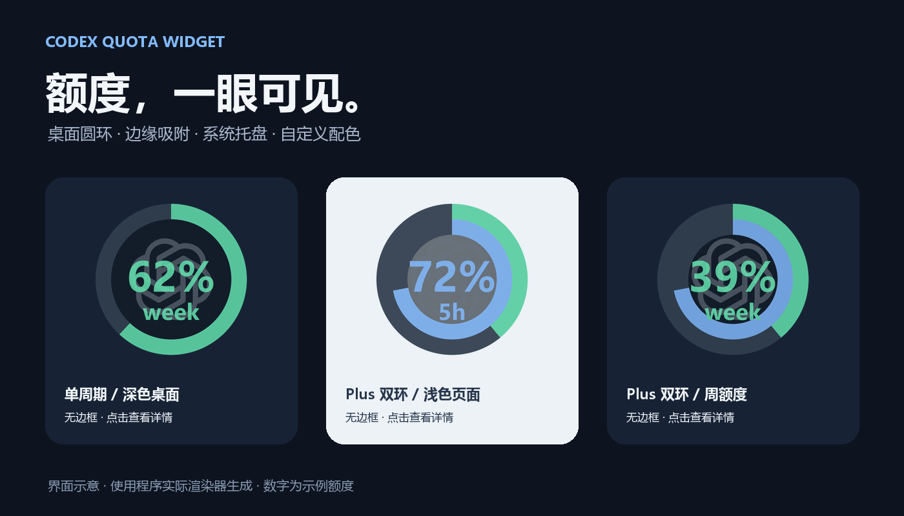
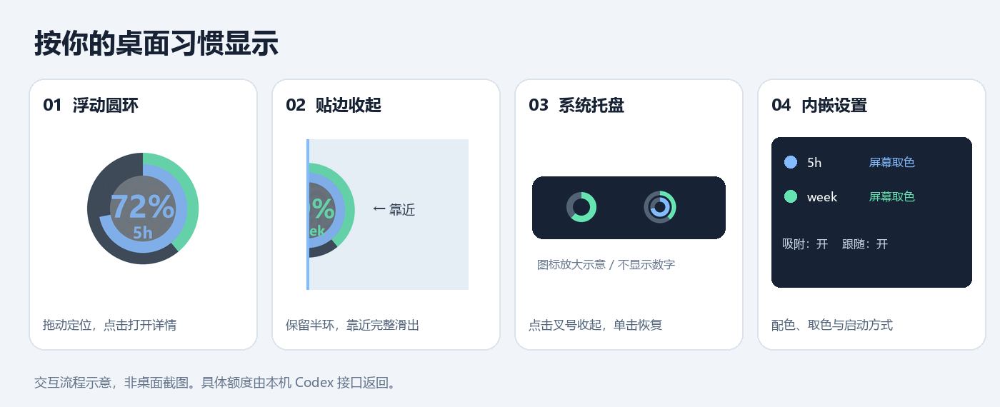

<div align="center">

# Codex Quota Widget

**让 Codex 剩余额度，成为桌面上随时可见的一圈颜色。**

[](https://github.com/HrrToT/codex-quota-widget/releases/latest)
[](https://github.com/HrrToT/codex-quota-widget/releases/latest)
[](LICENSE)

[下载安装包](https://github.com/HrrToT/codex-quota-widget/releases/latest) · [快速开始](#快速开始) · [使用说明](#使用说明) · [反馈问题](https://github.com/HrrToT/codex-quota-widget/issues)

</div>



一个独立、非官方的 Windows 桌面额度组件。读取本机已登录 Codex 的额度接口，以无边框透明圆环显示剩余额度，并提供边缘吸附、系统托盘、屏幕取色与跟随启动。

> 配图由程序实际圆环渲染器生成，额度数字是示例，不代表任何用户的真实额度。项目不隶属于 OpenAI。

## 快速开始

1. 安装并登录 Codex 桌面应用，或安装、登录 Codex CLI。
2. 从 [最新 Release](https://github.com/HrrToT/codex-quota-widget/releases/latest) 下载 `CodexQuotaWidget-1.0.0-windows-x64-setup.exe`，双击安装。
3. 启动组件。默认启用**边缘吸附**与**随 Codex 启动和退出**；如果使用 CLI 而非桌面应用，请在设置中改为“手动启动”或“登录 Windows 时启动”。
4. 点击圆环查看详情，点击详情底部“设置”调整配色和行为。

| 下载文件 | 适合谁 | 使用方法 |
|---|---|---|
| `…-setup.exe` | 希望有开始菜单与卸载入口 | 双击安装，无需管理员权限 |
| `…-portable.zip` | 希望解压即用 | 解压完整文件夹，运行 `CodexQuotaWidget.exe`；保留 `_internal` 文件夹 |
| `SHA256SUMS.txt` | 校验下载完整性 | 与 `Get-FileHash 文件名 -Algorithm SHA256` 对照 |

**Windows 10/11 x64；已在 Windows 11 验证。** 安装包和便携版内置 Python、Tkinter 与 Pillow，无需自行安装 Python。额度读取仍需本机可用且已登录的 Codex CLI；应用会寻找桌面应用自带的 CLI、PATH 中的 CLI 和常见 npm 安装路径。

安装目录默认为 `%LOCALAPPDATA%\Programs\CodexQuotaWidget`。设置保存到 `%LOCALAPPDATA%\CodexQuotaWidget\settings.json`，升级覆盖程序不会覆盖个人设置。便携版也使用同一配置目录，并可能根据所选启动模式注册当前用户的登录启动项。

## 使用说明



| 操作 | 效果 |
|---|---|
| 拖动圆环 | 移动位置；开启吸附时，松手后贴到最近边缘 |
| 鼠标离开贴边圆环 | 约 0.65 秒后收起一半 |
| 鼠标靠近 | 完整圆环滑出 |
| 点击数字或环体 | 展开额度详情 |
| 点击 `5h` / `week` 标签 | 在双周期中切换中央数字 |
| 点击“收起” | 详情卡片回到桌面圆环 |
| 点击“设置” | 在详情底部展开设置，再点一次收起 |
| 点击叉号 | 默认收起到系统托盘，程序继续运行 |
| 单击托盘图标 | 恢复组件 |
| 托盘右键 → 退出程序 | 完全退出组件与后台监测 |

### 圆环怎么看

- **内环：5 小时额度；外环：周额度。** 单周期账号显示单环。
- **数字表示剩余额度**，不是已用比例。Plus 或接口同时提供两个周期时显示双环。
- 周期按接口返回的时长识别，不固定把 `primary` 当作 5h，也不混合不同额度桶。
- 托盘是独立的小尺寸设计：单环或双环、没有数字和 Logo；悬停查看具体剩余额度。
- 缺失额度显示为未知，读取失败保留上次成功数据并在详情中提示。

### 配色与屏幕取色

5h 与周额度分别设置颜色，圆环、数字、标签、详情进度条和托盘同步更新。

| 风格 | 5h | 周额度 |
|---|---|---|
| 默认蓝绿 | `#83BBFF` | `#65E4B1` |
| 柔和雾蓝 / 暖砂 | `#AEC6DF` | `#D8BC9B` |

可以直接输入 `#RRGGBB`、打开颜色选择器，或点击“屏幕取色”。取色时组件暂时隐藏，点选屏幕颜色，按 **Esc** 取消；保存后生效。取色截图只在内存中暂存，不保存文件、不上传。

深色底与 OpenAI 图标均为 60% 不透明度；圆环与数字约为 84%。采用单窗口逐像素透明合成，避免多层窗口拖动不同步和透明色导致的文字红边。

### 启动与关闭

| 启动方式 | 行为 |
|---|---|
| 手动启动 | 只在手动运行时启动，不注册登录启动项 |
| 登录 Windows 时启动 | 登录后直接运行组件 |
| 随 Codex 启动和退出（默认） | 登录后开始监测；Codex 打开时显示，关闭后隐藏并停止额度读取 |

跟随模式每 3 秒识别桌面应用进程，CLI/app-server 不算桌面应用。Codex 关闭后，轻量监测进程与托盘仍保留，用于下次恢复。主动收起到托盘后，不会因额度刷新重新弹出。设置中的“点击叉号直接退出”可更改默认关闭行为。

## 数据与隐私

组件通过本机 `codex app-server` 的标准输入/输出调用 `account/rateLimits/read`，使用 CLI 当前登录的账号。不请求模型推理、不创建对话，也不读取或上传登录凭据。

- 每 5 分钟自动刷新，也可手动刷新。
- 仅保存位置、置顶、所选周期、颜色、吸附和启动偏好；不保存额度快照。
- 继承本机代理与 `CODEX_HOME`。如果 CLI 和桌面应用使用不同账号或不同 `CODEX_HOME`，显示的额度可能不同。
- 发布文件不包含 Codex CLI、个人配置、凭据或示例账号数据。

## 常见问题

**看不到圆环？** 检查 Codex 桌面应用是否打开，以及任务栏右下角的隐藏图标区域。跟随模式会在 Codex 未运行时隐藏组件；再次运行程序可打开设置。

**找不到 CLI？** 在 Codex 中登录后重试，或将 `CODEX_QUOTA_EXE` 环境变量设为实际 `codex.exe` 的完整路径。

**只有一个圆环？** 当前账号可能只提供一个周期。组件不会凭空补出不存在的额度；Plus 缺失的窗口显示未知。

**Windows 提示未识别的应用？** 当前 Release 尚未进行 Authenticode 代码签名，因此可能出现 SmartScreen 提示。请核对仓库来源和 SHA-256；不要关闭系统安全保护。

**卸载会删除个人设置吗？** 不会。卸载移除程序和指向该安装目录的登录启动项，保留用户配置。便携版删除前请先在设置中改为手动启动并退出。

## 开发与构建

```powershell
python -m venv .venv
.\.venv\Scripts\python.exe -m pip install -r requirements-build.txt
.\.venv\Scripts\python.exe quota_widget.py
.\.venv\Scripts\python.exe -m unittest discover -s tests
```

Windows 上安装 [Inno Setup 6](https://jrsoftware.org/isinfo.php) 后：

```powershell
.\packaging\build.ps1 -Python .\.venv\Scripts\python.exe -Iscc "C:\Path\To\Inno Setup 6\ISCC.exe"
```

输出位于 `release/`：安装包、便携 ZIP 和 SHA-256 文件。构建工具版本固定在 `requirements-build.txt`；当前发行版使用 Python 3.14 x64。开发环境要求 Python 3.10+、Tkinter 和 Pillow。

源码运行默认使用源码目录的 `settings.json`；可通过 `CODEX_QUOTA_SETTINGS` 覆盖配置路径以隔离测试。`--smoke-report 文件路径` 用于本机运行检查，12 秒后写报告并退出，不注册自动启动。

## 验证范围

额度解析、颜色保存、双周期切换、RGBA 渲染、吸附、托盘注册与恢复、设置展开、取色选取与取消已进行自动测试。真实账号的额度读取已验证；Plus 图形用模拟双周期数据验证。多显示器边界、实际重新登录后的自动启动和不同机器的体验仍欢迎反馈。

## 许可与致谢

代码采用 [MIT License](LICENSE)。OpenAI Logo 与商标不包含在 MIT 授权中，来源与说明见 [assets/SOURCE.md](assets/SOURCE.md)。运行时组件说明见 [THIRD_PARTY_NOTICES.md](THIRD_PARTY_NOTICES.md)。
